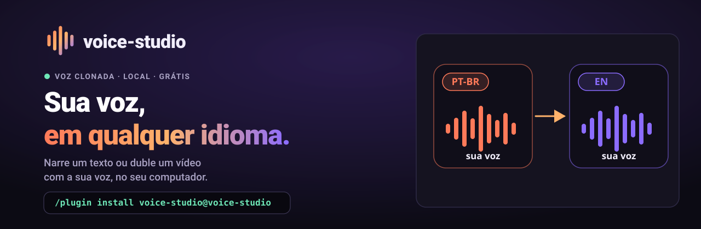

<p align="center">
  
</p>

<p align="center">
  <a href="https://github.com/nathanramorim/voice-studio/releases"></a>
  
  
  
</p>

<h3 align="center">Narre um texto ou duble um vídeo<br>com a sua voz, no seu computador.</h3>

---

## O que é

O **voice-studio** clona a sua voz **no seu próprio computador**. Você dá uma amostra de áudio (de 6 a 30 segundos falando) e ele:

- **guarda a sua voz num perfil** (amostra, consentimento e vocabulário de pronúncia por idioma);
- **fala o texto que você digitar**, com a sua voz (narração para reels, vídeos e apresentações);
- **traduz um áudio ou vídeo para outro idioma** com a sua voz, encaixando cada fala no tempo da mídia (o inglês é o idioma validado).

Funciona como plugin do **Claude Code**, com instruções prontas também para **agy (Antigravity)** e **Codex**. A tradução do texto é feita pelo agente; o áudio nunca sai da sua máquina.

> É voz gerada a partir de texto, não uma conversão da voz que já existe. O timbre vem da sua amostra; sotaque e naturalidade do idioma variam. **Ouça sempre o resultado antes de publicar.**

## Por que usar

| | |
|---|---|
| 🔒 **Tudo local** | A amostra, as falas e a transcrição ficam no seu computador. |
| 💸 **Grátis** | Usa o modelo XTTS-v2 e ferramentas abertas, sem assinatura de serviço de voz. |
| 🗣️ **Pronúncia sob controle** | Um vocabulário troca "IA" por "IÁ", "PR" por "PIER" e assim por diante, só na fala; a legenda não muda. |
| 🛡️ **Falas conferidas** | Cada fala gera várias versões e descarta as defeituosas (uma fala de 3 s que sai com 10 s, por exemplo). |
| 👤 **Perfis de voz** | Um perfil por voz ou sotaque, com amostra, consentimento e vocabulário por idioma. |
| 🌎 **Tradução de áudio ou vídeo** | Transcreve, o agente traduz e a sua voz fala no idioma escolhido, no tempo da mídia (áudio entra e sai como áudio; vídeo, como vídeo). |

## Requisitos

> **Cole isto na sua IA antes de instalar:**
>
> "Verifique os requisitos do voice-studio: se não tiver o `uv`, me pergunte e, com o meu ok, instale com `brew install uv` (ou `curl -LsSf https://astral.sh/uv/install.sh | sh`). Depois rode `uv run https://raw.githubusercontent.com/nathanramorim/voice-studio/main/scripts/requisitos.py checar`. Se faltar algo, me mostre a lista e peça o meu ok item por item. Rode `uv run https://raw.githubusercontent.com/nathanramorim/voice-studio/main/scripts/requisitos.py instalar --sim <item>` só para os itens que têm comando e que eu aprovar; os itens em que a coluna *Como resolver* diz que é com você ficam comigo: só me explique. Não aceite licenças nem declarações por mim. Depois instale o plugin com `claude plugin marketplace add nathanramorim/voice-studio` e `claude plugin install voice-studio@voice-studio`."

O script de requisitos só usa a biblioteca padrão do Python, então roda antes do clone (o repositório é público, não precisa de acesso). Com o repositório clonado, o mesmo vale como `uv run scripts/requisitos.py checar` (ou `--json`) e `uv run scripts/requisitos.py instalar [--sim] [item ...]` (sem nomes, cobre tudo o que falta; pergunta antes de cada item; `--sim` roda sem perguntar). Ele nunca aceita a licença do XTTS (`--accept-cpml`) nem declara que a voz é sua (`--confirm-own-voice`): isso é sempre com você.

| Ponto | O que precisa |
|---|---|
| **Onde roda** | Testado no **macOS com Apple Silicon** (CPU, sem GPU). Linux e Windows não foram testados. Agentes: Claude Code (plugin), agy e Codex (instruções prontas, ainda não validados); sem agente, a linha de comando funciona sozinha. No Apple Silicon, rode o `uv` com `--python cpython-3.11-macos-aarch64-none`: sem isso ele pode escolher um Python x86_64 (Rosetta) e o PyTorch não instala. |
| **Programas** | [`uv`](https://docs.astral.sh/uv/) 0.5 ou mais novo (instalado no teste: 0.9.7): `curl -LsSf https://astral.sh/uv/install.sh \| sh` ou `brew install uv`. Ele instala o **Python 3.11** exigido pelo motor (`>=3.11,<3.12`); você não instala Python à mão. `ffmpeg` com `ffprobe` (instalado no teste: 9.0): `brew install ffmpeg`. **Só para transcrever** (`traduzir`, `transcribe`): whisper.cpp com o binário `whisper-cli` (instalado no teste: 1.9.5): `brew install whisper-cpp`. |
| **Downloads na primeira execução** | Na primeira `uv run --extra xtts`, o `uv` baixa o motor (`coqui-tts`) e o PyTorch para o ambiente do `engine/` (cerca de 1 GB). Na primeira fala, o modelo **XTTS-v2** (cerca de 2 GB) é baixado para `~/Library/Application Support/tts/` no macOS ou `~/.local/share/tts/` no Linux (mude com `TTS_HOME`). O modelo do Whisper **não** é baixado sozinho: baixe um modelo ggml uma vez, por exemplo o `small` (cerca de 470 MB): `mkdir -p ~/.cache/whisper && curl -L -o ~/.cache/whisper/ggml-small.bin https://huggingface.co/ggerganov/whisper.cpp/resolve/main/ggml-small.bin`, e passe `--model ~/.cache/whisper/ggml-small.bin` (ou defina `VOICE_STUDIO_WHISPER_MODEL`). |
| **Contas e chaves** | Nenhuma. Não há API, login nem chave: tudo roda na sua máquina. |
| **Máquina** | Testado com 8 GB de RAM. Reserve cerca de 4 GB de disco (ambiente com PyTorch, modelo XTTS e modelo do Whisper). Em CPU, cada fala leva de 20 a 60 segundos. |
| **Licenças e limites** | Código MIT; o modelo XTTS-v2 é **Coqui CPML, somente uso não comercial**, aceito por você com `--accept-cpml` (ou `VOICE_STUDIO_ACCEPT_CPML=1`). Detalhes em [Licenças](#licenças-leia-antes-de-usar) e no [`NOTICE.md`](NOTICE.md). Idiomas além de `pt` e `en` saem `validated: false`. |
| **O que você fornece** | Uma **amostra da sua voz**: 6 a 30 s de fala contínua, sem música nem outras vozes (áudio ou vídeo). A declaração de que a voz é **sua** ou de quem autorizou (`--confirm-own-voice`) e o aceite da licença do modelo (`--accept-cpml`); o agente pergunta, nunca preenche por você. Para `traduzir`, o áudio ou vídeo de origem. |

Os perfis ficam em `~/.voice-studio/perfis/` (mude com `VOICE_STUDIO_HOME` ou `--perfis-dir`), sempre **fora** de qualquer repositório git.

## Instalação

**Como plugin do Claude Code**

```
/plugin marketplace add nathanramorim/voice-studio
/plugin install voice-studio@voice-studio
```

**Direto pela linha de comando**

```bash
git clone https://github.com/nathanramorim/voice-studio
cd voice-studio/engine
uv run --python 3.11 --extra xtts voice-studio --help
```

No **Mac com Apple Silicon**, use `--python cpython-3.11-macos-aarch64-none` (sem isso o `uv` pode escolher x86_64 e o PyTorch não instala).

**agy e Codex:** abra o repositório; as instruções estão em `GEMINI.md` (agy) e `AGENTS.md` (Codex) e apontam para a mesma skill e a mesma linha de comando.

## Como usar

**1. Perfil da sua voz** (a partir de uma gravação sua; guarda a amostra e o consentimento)

```bash
voice-studio perfil criar nathan minha-gravacao.mov --confirm-own-voice
voice-studio perfil vocab nathan exemplos/pronuncia-pt.json --lang pt
```

**2. Falar um texto com a voz do perfil, no idioma que quiser**

```bash
voice-studio falar "Vamos usar a IA hoje" --perfil nathan --lang pt --accept-cpml -o out
```

**3. Traduzir um áudio ou vídeo com a sua voz** (o agente traduz entre as duas fases)

```bash
voice-studio traduzir video.mp4 --para en --perfil nathan --model ggml-small.bin
# traduza `source` para `text` em segments.json (no agente, a skill faz isso por você)
voice-studio traduzir video.mp4 --para en --perfil nathan --segmentos segments.json --accept-cpml
```

No Claude Code, `/perfil-de-voz`, `/falar` e `/traduzir` conduzem esses passos e pedem o consentimento e o aceite da licença (`/clonar-voz` e `/dublar` continuam como atalhos). Os comandos de baixo nível `sample`, `speak`, `transcribe` e `dub` seguem disponíveis.

**Saída nunca sobrescreve a entrada.** `traduzir` e `dub` recusam um `--out` igual à entrada e uma saída que já existe; para substituir uma saída existente, passe `--sobrescrever` (a entrada nunca é sobrescrita).

**Idiomas.** `pt`, `en`, `es`, `fr`, `de` e `it`. Só `pt` e `en` foram medidos com falas reais; nos demais o relatório traz `validated: false` e a CLI avisa.

**Códigos de saída.** `0` ok. `1` erro de uso ou validação (nada foi gerado). `2` só em `falar` e `traduzir`: gerou, mas há fala(s) suspeita(s) (`ok: false`); confira o `report.json`. `speak` e `dub` (baixo nível) saem `0` mesmo com linha suspeita ou estouro de tempo: leia o `report.json` ou o resumo impresso.

**Pronúncia.** O `pronuncia.json` é um mapa `{"como aparece": "como falar"}`. Troca por palavra inteira, só no texto da voz. Siglas em maiúsculas só casam em maiúsculas (`"IA"` não troca o verbo `ia`). `exemplos/pronuncia-pt.json` registra o sotaque mineiro do autor; use como ponto de partida.

**Sotaque.** Ele vem da **sua amostra** e do vocabulário: o modelo não tem sotaque mineiro pronto. Gere de 3 a 4 versões e escolha ouvindo. A transcrição automática **não prova a pronúncia** (ela reescreve marcas para a grafia padrão), então um humano precisa ouvir.

## Segurança e privacidade

- **Consentimento:** só clone a **sua** voz ou a de quem autorizou. A linha de comando exige `--confirm-own-voice`, e o agente pergunta antes de passar essa opção.
- **Privacidade:** amostras, falas e vídeos nunca são enviados para fora nem versionados (o `.gitignore` bloqueia `wav`, `mp3`, `m4a` e `mp4`). Não publique a voz de ninguém sem permissão.
- **Local:** o agente só lê e escreve texto; o áudio não vai para a conversa.

### Licenças (leia antes de usar)

| Parte | Licença |
|---|---|
| Código deste repositório | MIT |
| Modelo **XTTS-v2** (usado por padrão) | **Coqui CPML: somente uso não comercial** |

Os pesos do modelo **não** estão neste repositório: são baixados na primeira geração, e você aceita a licença com `--accept-cpml` (ou `VOICE_STUDIO_ACCEPT_CPML=1`). Para uso comercial, troque o motor por outro de licença permissiva implementando a interface `synth.Synth`. Veja o [`NOTICE.md`](NOTICE.md).

## Versões

| Versão | Novidades |
|---|---|
| **0.2.1** | Requisitos conferidos e instalados por script: `scripts/requisitos.py checar` (tabela ou `--json`) e `instalar [--sim] [item ...]` (só os itens citados, ou tudo o que falta; pergunta antes de cada item; `--sim` roda sem perguntar), e um prompt pronto para colar na sua IA, dentro de Requisitos. Nunca aceita licença nem declaração por você. |
| **0.2.0** (não publicada como tag) | Perfis de voz com consentimento registrado, vocabulário de pronúncia por idioma, catálogo de 6 idiomas (`pt` e `en` validados), comandos `falar` e `traduzir`, entrada e saída de áudio ou vídeo, proteção contra sobrescrever a entrada (`--sobrescrever`), skill única com adaptadores para Claude Code, agy e Codex. Falta o QA manual com voz real. |
| **0.1.0** | Primeira versão: voz clonada local (XTTS-v2), narração com vocabulário de pronúncia, várias versões por fala com guarda de duração, dublagem por segmento, consentimento e aviso de licença, plugin com skill e os comandos `/clonar-voz` e `/dublar`. |

## Status e limites

- **Testado:** `speak` em português e inglês pela linha de comando, no macOS (Apple Silicon), e testes automáticos (com sintetizador simulado, sem baixar o modelo).
- **Ainda não validado:** perfil, `falar` e `traduzir` com voz e vídeo reais (a verificação manual é feita ouvindo); a instalação pelo marketplace do Claude Code; agy e Codex: instruções prontas, não validado (veja [`docs/validacao-multiagente.md`](docs/validacao-multiagente.md)).
- **Idiomas além de `pt` e `en`:** qualidade não verificada (`validated: false`).
- **Marcas difíceis** (como "Forge SDD") pedem ajustar a grafia falada até soar certo.
- **Planejado:** validação com falas reais dos demais idiomas.

## Desenvolvimento e contribuição

```bash
export UV_PROJECT_ENVIRONMENT=$HOME/.cache/voice-studio-venv   # ambiente fora do repositório
cd engine
uv run --python 3.11 --group dev pytest -q
uv run --python 3.11 --group dev ruff check .
```

O projeto segue o [Forge SDD](https://forge-sdd.org): regras em `sdd/memory/constitution.md` (IDs `VOZ-01` a `VOZ-10`) e decisões em `sdd/spec/adr/`. Para contribuir, leia o [`CONTRIBUTING.md`](CONTRIBUTING.md) e o [`CODE_OF_CONDUCT.md`](CODE_OF_CONDUCT.md); para falhas de segurança ou de privacidade da voz, o [`SECURITY.md`](SECURITY.md).

## Licença

[MIT](LICENSE)

O modelo XTTS-v2 segue a [Coqui CPML](https://coqui.ai/cpml).
