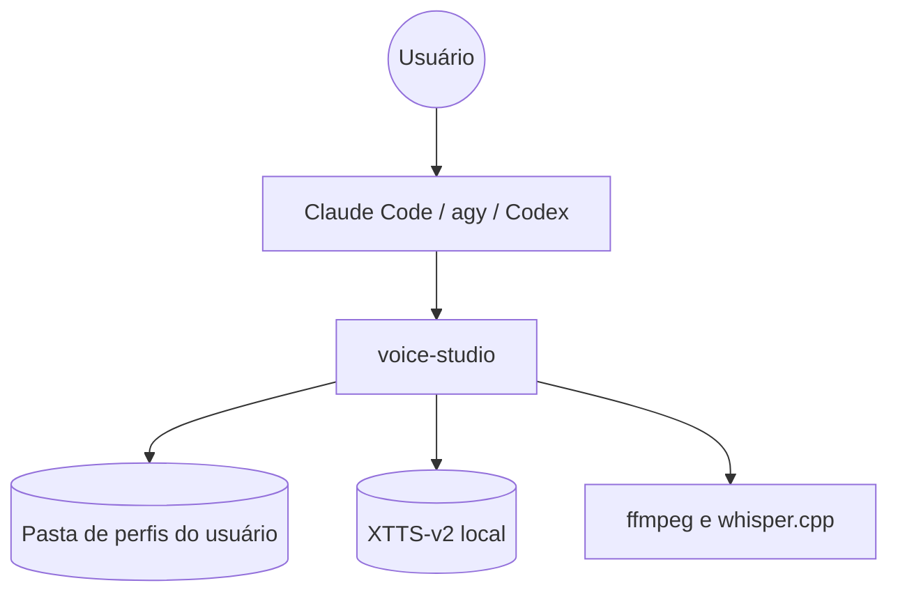
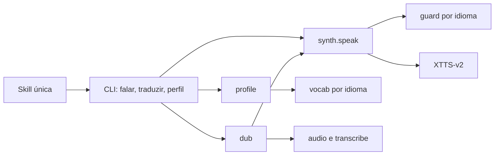
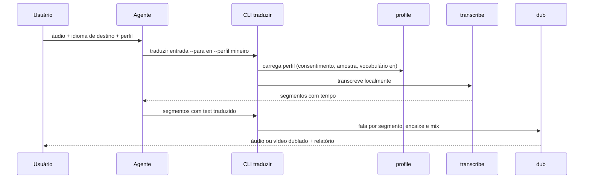

# Critérios — 01 Voz multilíngue, perfis e sotaque

## Restrições (Constitution)
`VOZ-01` consentimento no perfil; `VOZ-02` licença explícita; `VOZ-03` local; `VOZ-04` perfil fora do repositório; `VOZ-05` vocabulário por idioma; `VOZ-06` guarda de qualidade; `VOZ-07` honestidade sobre sotaque; `VOZ-08` skill única nos 3 agentes; `VOZ-09` motor injetável. `SEG-01` nomes e caminhos validados na borda; `SEG-02` escrita só dentro da pasta do perfil; `SEG-03` processos externos sem shell; `SEG-05` nada sensível em logs; `ARQ-04` sem dependência nova; `ARQ-06` comandos documentados; `ARQ-10` domínio fora da CLI; `DUP-01`/`DUP-03`/`DUP-04` um dono por conceito; `TST-01`/`TST-04` critérios automatizados e determinísticos.

## Modelo do módulo
completo — um módulo novo (`profile`) com persistência em disco e validação, mais extensões em `vocab`, `guard`, `dub`, `audio` e `cli`; decisão de armazenamento é estrutural (ADR-0002).

## Decisões do projeto aplicadas
ADR-0001 (voz local com XTTS, sotaque pela amostra e vocabulário). Rules: `voz-consentimento-e-privacidade`, `voz-pronuncia-e-qualidade`, `voz-multiagente`, `sdd-seguranca`, `sdd-reuso-e-duplicacao`. ADR-0002 a criar na `feat-01-01` (perfis: formato e pasta).

## O que já existe
| Procurei | Onde | Achei | Decisão | Justificativa |
|---|---|---|---|---|
| Consentimento e licença | `consent.py` | `require_consent`, `require_license` | reusar | O perfil chama as mesmas funções; consentimento continua com um único dono (`DUP-01`) |
| Vocabulário de pronúncia | `vocab.py` | `load`, `apply_spoken` (mapa único) | estender | Passa a escolher o mapa pelo idioma da fala; a troca em si não muda |
| Duração esperada por idioma | `guard.py` (`CPS` pt/en) | só pt e en calibrados | estender | Acrescenta es, fr, de, it com `validated: false` |
| Lista de idiomas | `synth.LANGS` | conjunto fixo | estender | Move para um único catálogo de idiomas com o estado "validado" (`DUP-04`) |
| Amostra a partir de mídia | `audio.extract_sample` | funciona com vídeo; ffmpeg lê áudio também | reusar | Aceita `.wav`/`.m4a` sem mudança |
| Mix da dublagem | `audio.mix_dub` | exige vídeo (`-map 0:v`) | estender | Ramo de saída só áudio |
| Dublagem por segmento | `dub.py` | `dub`, `load_segments`, encaixe e relatório | estender | Entrada áudio ou vídeo, `--para`, perfil |
| Transcrição local | `transcribe.py` | `transcribe` | reusar | Sem mudança |
| Geração com variações | `synth.speak` | N variações e guarda | reusar | `falar` e `traduzir` chamam o mesmo |
| Perfil de voz | — | nada | criar | Conceito novo; dono: `profile` (registrar em `sdd/spec/concepts.md`) |

## Dependências novas
Nenhuma (`ARQ-04`). O perfil usa `json`, `pathlib` e `shutil`; nenhuma consulta ao context7 é necessária (`SEG-07`).

## Diagramas

### Contexto

### Contêineres

### Sequência: traduzir um áudio para outro idioma

## Critérios de Aceitação Executáveis
Todos em `cd engine`, com sintetizador simulado (sem baixar modelo).
- `uv run pytest tests/test_profile.py -k criar`: cria perfil com amostra existente e `--confirm-own-voice`; sem a flag, falha; registra data e consentimento; copia a amostra para a pasta do perfil.
- `uv run pytest tests/test_profile.py -k seguranca`: nome com `..`, barra ou caractere de controle é rejeitado; perfil corrompido ou inexistente dá erro claro; pasta de perfis dentro de um repositório git gera erro.
- `uv run pytest tests/test_vocab.py -k idioma`: perfil com mapas `pt` e `en` aplica o mapa do idioma da fala e ignora o outro.
- `uv run pytest tests/test_languages.py`: aceita os 6 idiomas; rejeita outro; `en` e `pt` saem `validated: true`, os demais `false`.
- `uv run pytest tests/test_falar.py -k texto`: texto digitado + perfil gera fala com a amostra e o vocabulário do perfil; relatório traz `validated` e `ok`.
- `uv run pytest tests/test_traduzir.py -k audio`: entrada `.wav` gera saída de áudio (sem vídeo); entrada de vídeo gera vídeo; os dois com o mesmo relatório.
- `uv run pytest tests/test_traduzir.py -k perfil`: sem perfil ou com perfil sem consentimento, falha antes de tocar no motor.
- `uv run pytest && uv run ruff check` passam; `forge gate` passa.
- Manual (C1): gravar amostra mineira de 20 a 30 s, criar o perfil `mineiro`, gerar 5 frases do dia a dia com 3 versões cada e aprovar ouvindo; anotar as grafias faladas no perfil.
- Manual (C2): traduzir um clipe de 20 s pt -> en, ouvir e medir o tempo total; um idioma extra (es) só para confirmar que sai marcado `validated: false`.
- Manual (C3): abrir o repositório no agy e no Codex e seguir o checklist da skill; registrar o que funcionou.
