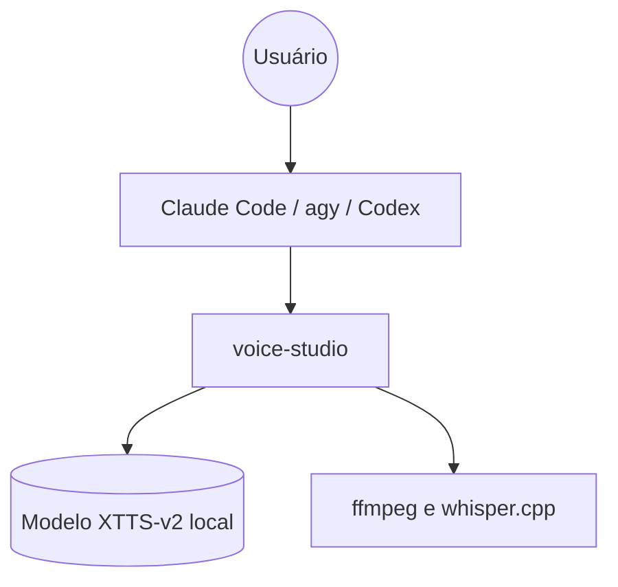
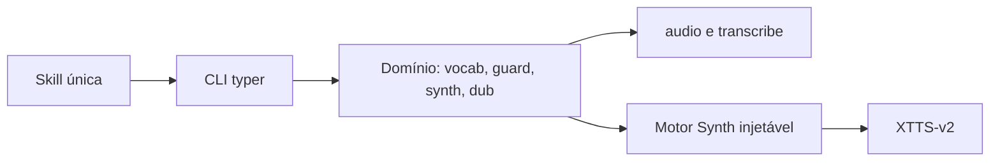

# Overview — voice-studio

Motor local e plugin de agente que clona a voz do usuário para (1) narrar um texto digitado e (2) dublar áudio ou vídeo para outro idioma, com perfis de idioma, sotaque e pronúncia. Tudo roda na máquina do usuário.

## Índice
- `stack.md` — tecnologias
- `modules.md` — componentes
- `flows.md` — fluxos principais
- `decisions.md` — decisões de design
- `concepts.md` — conceitos e donos (`DUP-01`)

---

## Arquitetura (C4 Model)

### Nível 1: Contexto

### Nível 2: Containers

